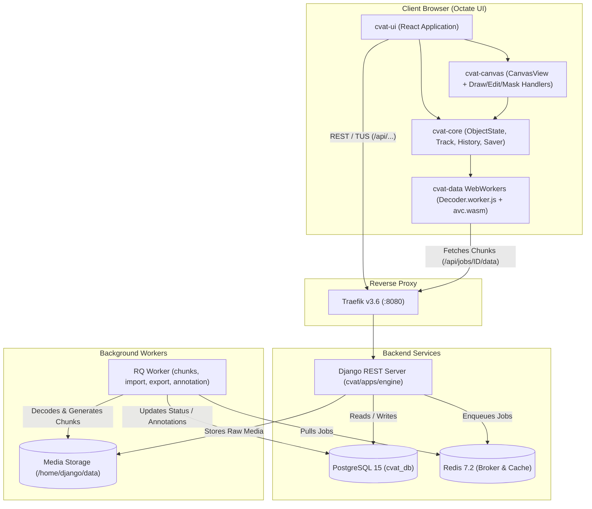

# OCTATE — Core Video Annotation Pipeline Audit

**Document Version:** 1.0  
**Date:** November 2026  
**Product:** Octate — AI-Assisted Surgical Video Annotation Platform  

---

## 1. System Communication Architecture

The following dependency graph illustrates the complete end-to-end communication flow between the frontend annotation editor, the browser WebWorker decoders, the Django REST API, the PostgreSQL relational database, Redis RQ queues, and background workers.

---

## 2. In-Depth Trace of the 13 Core Pipeline Stages

---

### Stage 1: Uploading a Video

* **Description:** The user selects a local MP4 video file to upload into Octate.
* **Relevant Source Files:**
  - Frontend: [`cvat-ui/src/components/create-task-page/`](file:///Users/tarbipyakurel/Developer/biolabel/cvat-ui/src/components/create-task-page/), [`cvat-core/src/task.ts`](file:///Users/tarbipyakurel/Developer/biolabel/cvat-core/src/task.ts), [`cvat-core/src/server-proxy.ts`](file:///Users/tarbipyakurel/Developer/biolabel/cvat-core/src/server-proxy.ts), [`cvat-core/src/axios-tus.ts`](file:///Users/tarbipyakurel/Developer/biolabel/cvat-core/src/axios-tus.ts)
  - Backend: [`cvat/apps/engine/views.py`](file:///Users/tarbipyakurel/Developer/biolabel/cvat/apps/engine/views.py), [`cvat/apps/engine/mixins.py`](file:///Users/tarbipyakurel/Developer/biolabel/cvat/apps/engine/mixins.py)
* **Classes & Functions:**
  - Frontend: `Task.save()`, `serverProxy.tasks.create()`, `serverProxy.tasks.uploadData()`
  - Backend: `TaskViewSet.create()`, `TaskViewSet.data()`, `UploadMixin.upload_data()`, `UploadMixin.append_tus_chunk()`
* **Frontend Components:** `CreateTaskPageComponent`, `FileManager`
* **Backend Endpoints:**
  - `POST /api/tasks` — Creates the `Task` entity in DB.
  - `POST /api/tasks/{id}/data` — Initiates TUS upload session.
  - `PATCH /api/tasks/{id}/data` (with TUS headers: `Upload-Offset`, `Upload-Length`) — Transfers binary video file chunks.
* **Database Models:**
  - `models.Task` (`name`, `status=ANNOTATION`, `mode=interpolation`)
  - `models.Data` (`chunk_size=36`, `image_quality=70`, `storage_method=CACHE`)
  - `models.ClientFile` (`file=upload_path_handler`)
  - `models.Storage` (`location=LOCAL`)
* **Worker Queues:** None (handled synchronously by Gunicorn/Django upload handler).
* **External Dependencies:** TUS open file uploading protocol (v1.0.0), TusFile.
* **Storage Path:** `/home/django/data/data/{data_id}/raw/{filename}.mp4`

---

### Stage 2: Decoding the Video and Extracting Frames

* **Description:** Once video upload completes, a background worker is triggered to decode container headers, extract frames, compute frame manifests, and write compressed video chunks.
* **Relevant Source Files:**
  - Backend: [`cvat/apps/engine/background.py`](file:///Users/tarbipyakurel/Developer/biolabel/cvat/apps/engine/background.py), [`cvat/apps/engine/task.py`](file:///Users/tarbipyakurel/Developer/biolabel/cvat/apps/engine/task.py), [`cvat/apps/engine/media_extractors.py`](file:///Users/tarbipyakurel/Developer/biolabel/cvat/apps/engine/media_extractors.py), [`cvat/apps/engine/cache.py`](file:///Users/tarbipyakurel/Developer/biolabel/cvat/apps/engine/cache.py)
* **Classes & Functions:**
  - `TaskCreator.init_callback_with_params()`
  - `task.py:initialize_task(db_task_id, data)`
  - `task.py:_collect_video_dataset_descriptors()`
  - `task.py:_create_static_chunks()`
  - `Mpeg4CompressedChunkWriter.save_as_chunk()`
  - `ImageManifestManager.create()`
* **Frontend Components:** Polling spinner / status progress bar (`bulk-progress.tsx`).
* **Backend Endpoints:** `GET /api/requests/{rq_id}` (polls status until `finished`).
* **Database Models:**
  - `models.Request` (`status=STARTED -> FINISHED`)
  - `models.Video` (`width`, `height`, `path`)
  - `models.Data` (`size=total_frames`, `start_frame=0`, `stop_frame=N`)
* **Worker Queues:** `import` (or `chunks`).
* **External Dependencies:** PyAV (`av.open(...)`), libavformat, libavcodec, FFmpeg.
* **Disk Artifacts:**
  - Manifest: `/home/django/data/data/{data_id}/manifest.jsonl`
  - Compressed chunks: `/home/django/data/data/{data_id}/compressed/{chunk_idx}.mp4` (contains 36 frames per chunk by default).

---

### Stage 3: Creating Internal Annotation Task and Job

* **Description:** As the final step of `initialize_task`, the system partitions the video frames into segments and assigns an annotation job.
* **Relevant Source Files:**
  - Backend: [`cvat/apps/engine/task.py`](file:///Users/tarbipyakurel/Developer/biolabel/cvat/apps/engine/task.py)
* **Classes & Functions:**
  - `task.py:_create_segments_and_jobs(db_task, ...)`
  - `task.py:_generate_segment_params()`
* **Database Models:**
  - `models.Segment` (`task=db_task`, `start_frame=0`, `stop_frame=total_frames - 1`, `type=PLAIN`)
  - `models.Job` (`segment=db_segment`, `type=ANNOTATION`, `stage=ANNOTATION`, `state=NEW`)
* **Relationship:** For single video annotation, 1 `Task` maps to 1 `Segment` and 1 primary `Job`. Octate will automatically navigate the user directly into this `Job`.

---

### Stage 4: Loading Frames into the Browser

* **Description:** When the user enters the annotation workspace, the client requests metadata and stream-fetches video chunks, decoding frames in WebWorkers.
* **Relevant Source Files:**
  - Frontend: [`cvat-core/src/frames.ts`](file:///Users/tarbipyakurel/Developer/biolabel/cvat-core/src/frames.ts), [`cvat-core/src/session.ts`](file:///Users/tarbipyakurel/Developer/biolabel/cvat-core/src/session.ts), [`cvat-data/src/ts/cvat-data.ts`](file:///Users/tarbipyakurel/Developer/biolabel/cvat-data/src/ts/cvat-data.ts), [`cvat-data/src/ts/3rdparty/Decoder.worker.js`](file:///Users/tarbipyakurel/Developer/biolabel/cvat-data/src/ts/3rdparty/Decoder.worker.js)
  - Backend: [`cvat/apps/engine/views.py`](file:///Users/tarbipyakurel/Developer/biolabel/cvat/apps/engine/views.py)
* **Classes & Functions:**
  - Frontend: `getFrame()`, `FrameDecoder`, `PrefetchAnalyzer`, `FrameData`
  - Backend: `JobViewSet.data()`, `_JobDataGetter.__call__()`
* **Frontend Components:** `AnnotationPageContainer`, `PlayerComponent`
* **Backend Endpoints:**
  - `GET /api/jobs/{id}/data/meta` — Returns frame dimensions, total count, chunk size, deleted frames.
  - `GET /api/jobs/{id}/data?type=chunk&number={idx}&quality=compressed` — Returns binary MP4 chunk buffer (`application/octet-stream`).
* **Decoding Mechanism:**
  - Video chunks (`.mp4`) are transferred as `ArrayBuffer` directly to `Decoder.worker.js`.
  - The WebWorker executes Broadway/AVC (`avc.wasm`) in WebAssembly to decompress raw YUV/RGBA pixel buffers into bitmaps without UI-thread lag.
* **Client Caching:** Up to 2 GB decoded frame cache stored in `frameDataCache[jobID]`.

---

### Stage 5: Rendering Frames on the Annotation Canvas

* **Description:** Displaying the decoded pixel bitmap and setting up SVG coordinates.
* **Relevant Source Files:**
  - Frontend: [`cvat-canvas/src/typescript/canvasView.ts`](file:///Users/tarbipyakurel/Developer/biolabel/cvat-canvas/src/typescript/canvasView.ts), [`cvat-canvas/src/typescript/canvasModel.ts`](file:///Users/tarbipyakurel/Developer/biolabel/cvat-canvas/src/typescript/canvasModel.ts)
* **Classes & Functions:**
  - `CanvasView.setup()`
  - `CanvasView.drawBackground()`
  - `CanvasView.transform()`
* **DOM Elements:**
  - `<canvas id="cvat_canvas_background">` — Hardware-accelerated 2D context where `ctx.drawImage(bitmap, 0, 0)` draws the video frame.
  - `<svg id="cvat_canvas_content">` — Scalable Vector Graphics overlay sharing exact pixel coordinates with the video frame, rendered with CSS matrix transformations for zoom/pan.

---

### Stage 6: Drawing & Editing Shapes (Boxes, Polygons, Masks)

* **Description:** User creates or modifies geometric annotations.
* **Relevant Source Files:**
  - Frontend: [`cvat-canvas/src/typescript/drawHandler.ts`](file:///Users/tarbipyakurel/Developer/biolabel/cvat-canvas/src/typescript/drawHandler.ts), [`editHandler.ts`](file:///Users/tarbipyakurel/Developer/biolabel/cvat-canvas/src/typescript/editHandler.ts), [`masksHandler.ts`](file:///Users/tarbipyakurel/Developer/biolabel/cvat-canvas/src/typescript/masksHandler.ts)
* **Classes & Functions:**
  - `DrawHandler.draw()`
  - `EditHandler.edit()`
  - `MasksHandler.draw()`
  - `svg.js` + `svg.patch.ts`
* **Supported Shapes:**
  - **Rectangle / Bounding Box:** SVG `<rect>` with 8 corner/edge resize handles.
  - **Polygon / Polyline:** SVG `<polygon>` with draggable vertex handles and edge split points.
  - **Segmentation Masks:** Interactive HTML5 Canvas brush/eraser; converts bitmap masks to RLE (Run-Length Encoding) and vector paths.
  - **Points, Ellipses, Skeletons:** Dedicated SVG sub-elements.

---

### Stage 7: Managing Timelines, Keyframes & Object Interpolation

* **Description:** Tracking object motion across frames and distinguishing CVAT's native interpolation from AI tracking.
* **Relevant Source Files:**
  - Frontend: [`cvat-core/src/annotations-objects/track.ts`](file:///Users/tarbipyakurel/Developer/biolabel/cvat-core/src/annotations-objects/track.ts), [`cvat-core/src/annotations-objects/rectangle-track.ts`](file:///Users/tarbipyakurel/Developer/biolabel/cvat-core/src/annotations-objects/rectangle-track.ts), [`cvat-core/src/annotations-objects/poly-track.ts`](file:///Users/tarbipyakurel/Developer/biolabel/cvat-core/src/annotations-objects/poly-track.ts)
* **Classes & Functions:**
  - `Track.get(frame)`
  - `Track.boundedKeyframes(targetFrame)`
  - `RectangleTrack.interpolatePosition(leftPosition, rightPosition, offset)`
* **The Critical Distinction:**
  - **CVAT Built-in Interpolation:**
    - Pure **mathematical linear interpolation** computed entirely client-side in TypeScript.
    - Calculates coordinates as: `point[i] = left[i] + (right[i] - left[i]) * offset`.
    - **No image processing or feature matching occurs.** If an instrument moves non-linearly, linear interpolation will drift unless the user places intermediate keyframes.
  - **AI-Based Object Tracking:**
    - Computer vision models (e.g. OpenCV Tracker MIL, SiamRPN, SAM 2 Video Tracker).
    - Inspects video frame pixels and extracts visual appearance embeddings to re-localize targets.

---

### Stage 8: Maintaining Object Identity Across Frames

* **Description:** Associating bounding boxes and masks across frames to track a single surgical tool throughout a video.
* **Relevant Source Files:**
  - Frontend: [`cvat-core/src/annotations-objects/track.ts`](file:///Users/tarbipyakurel/Developer/biolabel/cvat-core/src/annotations-objects/track.ts), [`cvat-canvas/src/typescript/mergeHandler.ts`](file:///Users/tarbipyakurel/Developer/biolabel/cvat-canvas/src/typescript/mergeHandler.ts), [`splitHandler.ts`](file:///Users/tarbipyakurel/Developer/biolabel/cvat-canvas/src/typescript/splitHandler.ts)
* **Classes & Functions:**
  - `Track` (persistent `clientID`, linked to `labelID`)
  - `MergeHandler.merge()` (combines two shapes on different frames into one continuous track)
  - `SplitHandler.split()` (terminates a track at frame $K$ and begins a new track)
* **Data Representation:**
  - `Track` maintains a dictionary of shapes indexed by keyframe number: `shapes: Record<number, TrackedShape>`.
  - `outside: boolean` flags whether the object has exited the surgical field of view.

---

### Stage 9: Undo/Redo & State Management

* **Description:** Instant client-side state recovery for drawing, transformations, deletions, and attribute changes.
* **Relevant Source Files:**
  - Frontend: [`cvat-core/src/annotations-history.ts`](file:///Users/tarbipyakurel/Developer/biolabel/cvat-core/src/annotations-history.ts)
* **Classes & Functions:**
  - `HistoryTransaction`
  - `AnnotationsHistory.undo()`, `AnnotationsHistory.redo()`
  - `HistoryActions` (create, delete, modify, merge, split)
* **Properties:**
  - Depth limit: `MAX_HISTORY_LENGTH = 32`.
  - Atomic transaction groupings ensure complex multi-object edits undo cleanly in a single step.

---

### Stage 10: Saving Annotations to the Backend

* **Description:** Persisting client-side edits to PostgreSQL.
* **Relevant Source Files:**
  - Frontend: [`cvat-core/src/annotations-saver.ts`](file:///Users/tarbipyakurel/Developer/biolabel/cvat-core/src/annotations-saver.ts), [`cvat-core/src/server-proxy.ts`](file:///Users/tarbipyakurel/Developer/biolabel/cvat-core/src/server-proxy.ts)
  - Backend: [`cvat/apps/engine/views.py`](file:///Users/tarbipyakurel/Developer/biolabel/cvat/apps/engine/views.py), [`cvat/apps/dataset_manager/task.py`](file:///Users/tarbipyakurel/Developer/biolabel/cvat/apps/dataset_manager/task.py)
* **Classes & Functions:**
  - Frontend: `AnnotationsSaver.save()`, `serverProxy.annotations.saveAnnotations()`
  - Backend: `JobViewSet.annotations()`, `task.py:put_job_data()`, `task.py:patch_job_data()`
* **Backend Endpoints:**
  - `PUT /api/jobs/{id}/annotations` (Full atomic overwrite)
  - `PATCH /api/jobs/{id}/annotations?action=create|update|delete` (Incremental differential save)
* **Database Models:**
  - `models.LabeledTrack` (`job_id`, `label_id`, `frame=start_frame`)
  - `models.TrackedShape` (`track_id`, `frame`, `points`, `outside`, `keyframe`, `type=rectangle|polygon|mask`)
  - `models.TrackedShapeAttributeVal` (`spec_id`, `value`)
  - `models.LabeledShape` (for non-tracked standalone shapes)
* **Response & Reconciliation:** Backend responds with the saved records and canonical database IDs (`serverID`). Frontend updates client objects via `_updateSavedObjects`.

---

### Stage 11: Loading Previously Saved Annotations

* **Description:** Rebuilding the annotation collection when opening an existing job.
* **Relevant Source Files:**
  - Frontend: [`cvat-core/src/session.ts`](file:///Users/tarbipyakurel/Developer/biolabel/cvat-core/src/session.ts), [`cvat-core/src/annotations-collection.ts`](file:///Users/tarbipyakurel/Developer/biolabel/cvat-core/src/annotations-collection.ts)
  - Backend: [`cvat/apps/engine/views.py`](file:///Users/tarbipyakurel/Developer/biolabel/cvat/apps/engine/views.py), [`cvat/apps/dataset_manager/task.py`](file:///Users/tarbipyakurel/Developer/biolabel/cvat/apps/dataset_manager/task.py)
* **Backend Endpoints:** `GET /api/jobs/{id}/annotations`
* **Execution Flow:**
  - Backend reads relational rows from `cvat_db` via `dm.task.get_job_data(job_id)`.
  - Serializes via `LabeledDataSerializer`.
  - Frontend `AnnotationsCollection.import(data)` unpacks tracks, shapes, keyframes, and attributes into memory.

---

### Stage 12: Importing and Exporting Annotation Data

* **Description:** Converting annotations into standard computer vision formats (CVAT for Video, YOLO, COCO, Pascal VOC, Mask archives).
* **Relevant Source Files:**
  - Backend: [`cvat/apps/engine/mixins.py`](file:///Users/tarbipyakurel/Developer/biolabel/cvat/apps/engine/mixins.py), [`cvat/apps/dataset_manager/export.py`](file:///Users/tarbipyakurel/Developer/biolabel/cvat/apps/dataset_manager/export.py), [`cvat/apps/dataset_manager/task.py`](file:///Users/tarbipyakurel/Developer/biolabel/cvat/apps/dataset_manager/task.py)
* **Classes & Functions:**
  - `DatasetMixin.initiate_dataset_export()`
  - `DatasetExporter.enqueue_job()`
  - `export.py:export_job()` / `export_task()`
  - Datumaro dataset converters (`DatumaroTaskFormat`)
* **Backend Endpoints:**
  - `POST /api/tasks/{id}/dataset/export?format={format}&save_images=false` — Enqueues background export. Returns `rq_id`.
  - `GET /api/requests/{rq_id}` — Polls export status.
  - `GET /api/tasks/{id}/dataset/export?rq_id={rq_id}` — Downloads generated ZIP/archive.
* **Worker Queue:** `export` (processed by `cvat_worker`).

---

### Stage 13: Managing Asynchronous Background Operations

* **Description:** Tracking asynchronous tasks (video decoding, chunking, dataset exports).
* **Relevant Source Files:**
  - Backend: [`cvat/apps/engine/background.py`](file:///Users/tarbipyakurel/Developer/biolabel/cvat/apps/engine/background.py), [`cvat/apps/engine/views.py`](file:///Users/tarbipyakurel/Developer/biolabel/cvat/apps/engine/views.py)
* **Classes & Functions:**
  - `AbstractRequestManager.enqueue_job()`
  - `RequestViewSet` (`GET /api/requests`, `GET /api/requests/{id}`)
* **Database Models:**
  - `models.Request` (`id=UUID`, `action`, `target`, `status=QUEUED|STARTED|FINISHED|FAILED`, `message`, `result_url`)
* **Scheduler:** `rqscheduler` maintains recurrent cache sweeps and failed job cleanup.
